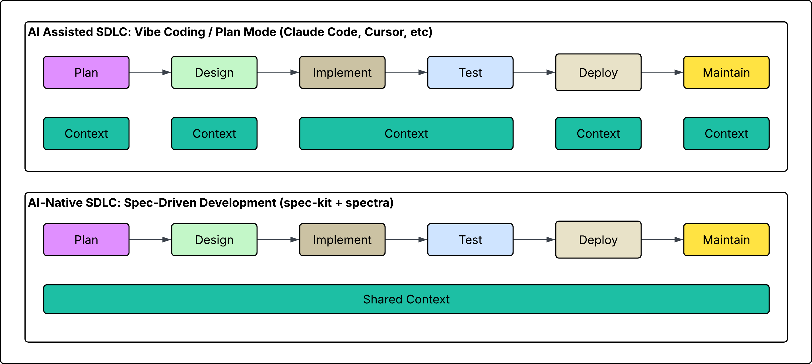
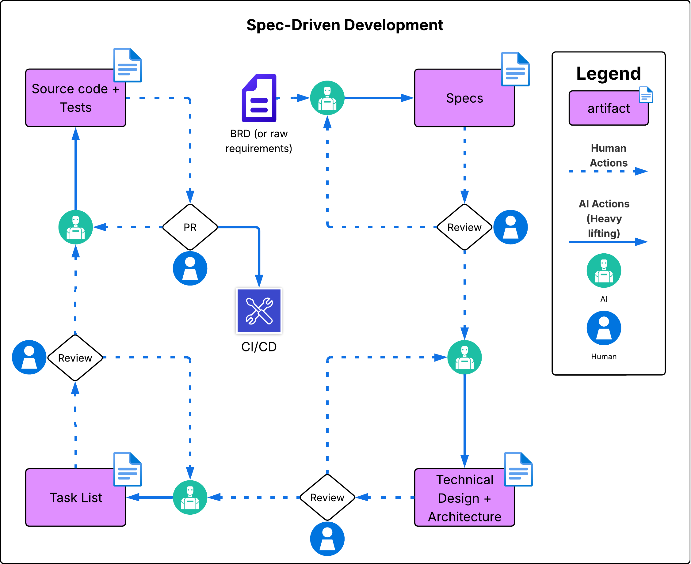
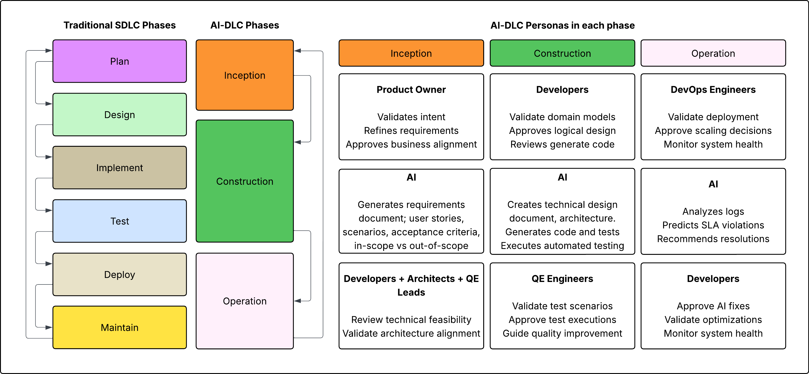

<div align="center">


# SPECTRA

**Agentic software engineering across the entire SDLC**

<sub>An extension by TELUS Digital that enhances [GitHub Spec Kit](https://github.com/github/spec-kit): agents that take spec-driven development across the entire software development lifecycle. You install and manage it with Spec Kit's own `specify` CLI.</sub>

</div>

---

## Table of Contents

- [AI-Assisted VS AI-Native](#ai-assisted-vs-ai-native)
- [Spec-Driven Development](#spec-driven-development)
- [AI-DLC](#ai-dlc)
- [Agents](#agents)
- [Starting on an existing codebase](#starting-on-an-existing-codebase)
- [Security, policy, and compliance](#security-policy-and-compliance)
- [Installation](#installation)
  - [Keep current](#keep-current)
  - [Projects with more than one agent](#projects-with-more-than-one-agent)
  - [Remove](#remove)
- [Support and compatibility](#support-and-compatibility)
- [License and trademarks](#license-and-trademarks)
- [Disclaimer](#disclaimer)

---

Spectra **builds on top of** [](https://github.com/github/spec-kit) — it does not replace it.
Spec Kit gives you spec-driven development (`specify`, `plan`, `tasks`, `implement`); Spectra adds
focused, production-ready agents for the work that surrounds the code: architecture decisions, design,
quality gates, documentation, delivery, and more. These capabilities ship together as a single
self-contained Spec Kit extension, `spectra`, whose commands all live under the `speckit.spectra.*`
namespace. You install Spec Kit first, then add the Spectra extension onto any Spec Kit project.

Spectra is built and maintained by TELUS Digital.

> **Who this README is for — developers** who want to install and use the Spectra extension in their
> Spec Kit projects. That's everything below. Spectra has a single maintainer and accepts no outside
> contributions; [CONTRIBUTING.md](CONTRIBUTING.md) is maintainer notes, kept public so the build and
> release rules are inspectable.

> 📚 **New to spec-driven development and Spec Kit?** There is a course handbook:
> **[Spec-Driven Development — Course Handbook](https://expert-adventure-77nryn7.pages.github.io/e-learning/)**.

## AI-Assisted VS AI-Native
Vibe coding and plan mode — Claude Code, Cursor, and the rest — supercharge a single phase. But each phase runs in its own session: the agent rebuilds its understanding from scratch every time, and the spec, design, tests, and code drift apart at every hand-off. That's AI-assisted — a faster typist. True AI-native engineering keeps one context intact across the whole lifecycle, so every phase builds on the last instead of starting cold.



SPECTRA makes spec-driven development truly AI-native. Every phase reads and writes one shared, durable context — the spec, plan, design, tasks, and code stay in lockstep through a tight, repeating loop, with a human owning the gate at each step. Because that context is shared, every agent stays in full compatibility with the standards and guardrails set for the system — nothing drifts out of policy from one phase to the next. Continuity is the design goal; speed and quality follow from it.

## Spec-Driven Development

Spec-Driven Development flips the script on traditional software development. For decades, code has
been king — specifications were just scaffolding we built and discarded once the "real work" of
coding began. Spec-Driven Development changes this: specifications become executable, directly
generating working implementations rather than just guiding them.

Spec Kit runs that loop in four core phases:

```text
spec  →  plan  →  tasks  →  implement
```



Spec Kit ships the **skeleton** — the core spec-driven loop above. **Spectra builds on top of it**,
adding specialized agents across every phase of the SDLC: foundation and governance, requirements,
architecture, planning, implementation, testing, and delivery.

## AI-DLC

**AI-DLC** is AWS's [AI-Driven Development Life Cycle](https://aws.amazon.com/blogs/devops/ai-driven-development-life-cycle/)
— introduced to fix a structural limit of the traditional SDLC: it's built around **humans**, with AI
bolted on at the edges. AI-DLC inverts that and puts **AI at the centre** — AI drafts the plan and does
the heavy lifting, while humans review and approve at each gate. It collapses the classic SDLC phases
into three: **Inception → Construction → Operation**.



That is exactly the Spectra model. Spectra already runs this way on a conventional SDLC, and it's
**ready for AI-DLC out of the box**: its loop, shared context, and human gates map straight onto
AI-DLC's three phases — so adopting Spectra is itself how a team makes the shift, without giving up
the discipline that keeps quality high. Inside every phase the same pattern repeats — **the team
validates at a gate, AI drafts and builds, the team reviews** — and the same agents from the
[roster below](#agents) slot straight into each phase:

## Agents

Every Spectra roster is built from two kinds of agents — a required **core** that runs the SDLC
end-to-end, plus optional **add-ons** you switch on as the domain demands. The full roster — each
agent's SDLC and AI-DLC phase, type, and status, then what it does and how to run it — lives in
**[AGENTS_LIST.md](AGENTS_LIST.md)**.

## Starting on an existing codebase

On a brownfield project, five SPECTRA agents lay the foundation the constitution is built from. Run them
in this order, and run the constitution after each one:

1. `/speckit-spectra-kb-vault` *(optional)* — import knowledge kept outside the repository: wiki pages,
   exported documents, design notes. Policy sources land in their own `<kind>-source/` folder for the
   owning agent to read, never in that agent's document.
2. `/speckit-spectra-domain-analyzer`, then `/speckit-constitution` — **create** the constitution.
3. `/speckit-spectra-methodology`, then `/speckit-constitution` — **amend** it.
4. `/speckit-spectra-test-strategy`, then `/speckit-constitution` — **amend** it.
5. `/speckit-spectra-deployment-strategy`, then `/speckit-constitution` — **amend** it.

**Why the constitution runs after each agent.** Each agent ends by handing you its own ready-to-paste
`/speckit-constitution` line, built from the guardrails you accepted in its round. Running it before the
next agent means that agent finds a ratified constitution: each later agent detects the constitution,
switches its goal to update, and proposes only what it does not already say — so no rule gets two
sources, and nothing you already ratified is offered to you again. An imported document is read as what
someone *claimed*, never as current practice: only the code and history decide that, and only your
answers adopt a guardrail.

**Declare the artifact root in the first constitution run.** Add a line such as `Artifact root: docs/` to
the constitution when you create it — or `Artifact root: documents/` where `docs/` is published by GitHub
Pages, MkDocs, or Docusaurus. Every later agent reads it, and stops asking where its document should go.

On a greenfield project, skip the import and start with the domain analyzer; the order is otherwise the
same. With an agent other than Claude, type the dotted form of each command, such as
`/speckit.spectra.domain-analyzer`.

## Security, policy, and compliance

**Spectra introduces no new trust boundary.** It is not another AI vendor, not another model, and not
another data path. Spectra ships as *instructions* — Markdown command files that Spec Kit registers
with the AI coding agent your organization has already approved. Those instructions are executed **by
that agent**, inside your existing environment. Whatever governs the agent therefore already governs
Spectra.

### Your controls, inherited unchanged

| Your existing control | How it applies to Spectra |
|---|---|
| Approved AI vendor and model | Unchanged — Spectra adds no model and makes no inference calls of its own. |
| Data handling, residency, and retention | Unchanged — prompts and source travel the agent's existing path, never a Spectra one. |
| Identity, SSO, and access control | Unchanged — Spectra holds no credentials of its own. `create-pr` uses your existing `git` / `gh` login, and confirms before any push. |
| Network egress, proxy, and DLP | Unchanged — Spectra opens no channel the agent does not already use. |
| Audit and logging | Unchanged — agent activity is captured exactly as it was before. |

Because those controls sit on the *tool* rather than on Spectra, **they cascade automatically**. There
is no second policy to author, no second vendor assessment to run, and no path by which Spectra can
operate outside the boundary the agent is already held to.

### The same holds for any agent

The model is deliberately tool-agnostic. A team standardized on **Claude** gets agentic SDLC coverage
under the rules already approved for Claude. A client running **Kiro**, **Gemini**, **Copilot**,
**Cursor**, or any other agent Spec Kit supports gets the same capabilities under *their* approvals.

Commands are authored once in Spec Kit's generic format and translated into each agent's native form
at install time, so the governing tool changes while Spectra does not. Governance travels with the
tool the organization chose — which is precisely why adopting Spectra does not reopen a compliance
review.

### What Spectra adds on top

Inheriting the perimeter is the floor, not the ceiling. Spectra is also built to make policy
*enforceable* rather than aspirational:

- **Standards encoded once.** The Guardrails agent writes your coding, security, and architecture
  standards into the project constitution, and every downstream agent inherits them — so a standard
  is applied by construction instead of by memory.
- **A human gate at every phase.** No phase advances without explicit approval. AI drafts and builds;
  people decide.
- **Traceability by default.** Spec, plan, tasks, and code stay linked in one shared context, so any
  change can be traced back to the intent that authorized it.
- **Dedicated compliance agents.** The roster covers GDPR, HIPAA, SOC 2, PCI-DSS, ISO 27001/27701,
  SOX, the EU AI Act, Canadian privacy (PIPEDA / PHIPA / Law 25), FDA 21 CFR Part 11 / IEC 62304, and
  WCAG. **Most are still under development** — check their status in [AGENTS_LIST.md](AGENTS_LIST.md#agents-at-a-glance) before depending on
  one.

### Supply chain

- **Markdown only.** The published extension is 14 command files and 13 templates, plus its licence,
  notice, trademark policy, and changelog. No scripts, no binaries, no post-install hooks: TELUS Digital
  ships no executable code. Spec Kit installs the files, and the agent you already approved runs them.
  Read it yourself at [`spectra/`](spectra/) or inside
  [`docs/packages/spectra.zip`](docs/packages/spectra.zip).
- **No telemetry.** SPECTRA makes no network calls of its own. Spec Kit fetches the public catalog and
  package when you install or update; nothing reports on you, your code, or your project.
- **No credentials to grant.** The catalog is public — no GitHub login, no token, no `gh` setup.
- **Auditable and pinnable.** Apache-2.0 with the source in the open, and every extension pins the
  Spec Kit version it was tested against (`requires.speckit_version`). Commit
  `.specify/extension-catalogs.yml` and the resolved source travels with the repository.

## Installation

SPECTRA installs **into** a Spec Kit project with Spec Kit's own `specify` CLI, and its catalog is
**public**: there's no GitHub login, token, or `gh` setup involved. You don't need to clone this repo.
These instructions were checked against Spec Kit 1.4.5.

**Before you start**, you need [`uv`](https://docs.astral.sh/uv/) and Git (uv uses Git to fetch Spec
Kit from GitHub), and internet access to `github.com` and `raw.githubusercontent.com`.

<details>
<summary>Don't have <code>uv</code> yet?</summary>

```bash
# macOS / Linux
curl -LsSf https://astral.sh/uv/install.sh | sh

# Windows (PowerShell)
powershell -ExecutionPolicy ByPass -c "irm https://astral.sh/uv/install.ps1 | iex"
```

Open a new terminal afterwards so `uv` is on your `PATH`. See the
[uv installation docs](https://docs.astral.sh/uv/getting-started/installation/) for package-manager
alternatives.

</details>

**1. Install Spec Kit** (once per machine):

```bash
uv tool install specify-cli --from git+https://github.com/github/spec-kit.git
```

**2. Initialize a Spec Kit project.** Skip this if the folder already has `.specify/`. Run it inside
your project folder; it asks which coding agent you use and registers Spec Kit's commands for it:

```bash
specify init --here
```

Run the next steps, and every SPECTRA command, from **inside** that project. New to spec-driven
development? Read the [Spec Kit docs](https://github.github.io/spec-kit/) first: SPECTRA assumes you're
comfortable with the `specify → plan → tasks → implement` loop.

**3. Register the SPECTRA catalog** (once per project):

```bash
specify extension catalog add https://raw.githubusercontent.com/telus-digital/spectra/main/catalog.json --name spectra --priority 5 --install-allowed
```

`--install-allowed` is required: catalogs are discovery-only by default, which blocks
`specify extension add` from installing anything in them. This writes the catalog into
`.specify/extension-catalogs.yml`:

```yaml
catalogs:
  - name: "spectra"
    url: "https://raw.githubusercontent.com/telus-digital/spectra/main/catalog.json"
    priority: 5
    install_allowed: true
```

**Commit `.specify/extension-catalogs.yml`** so everyone who clones the project inherits the catalog,
with no per-developer setup.

**4. Install SPECTRA, then restart your agent:**

```bash
specify extension add spectra
```

SPECTRA ships as a **single extension**: `specify extension add spectra` registers every
`speckit.spectra.*` command at once. **Restart your AI agent** so it picks up the new commands, then
run one. On Claude:

```
/speckit-spectra-adr We should standardize on PostgreSQL for all primary data stores
```

Spec Kit translates each command into your agent's native format at install time, so the extension
supports every agent, but the **trigger you type differs by agent**:

- **Claude** installs commands as *skills*, invoked with a leading slash and dashes: `/speckit-spectra-adr ...`.
- **Other agents** register it under a slightly different trigger. For example, kiro-cli keeps the
  dots: `/speckit.spectra.adr ...`.

The examples in this README use Claude's form; adjust the trigger for your agent. Your agent's own
command or skill list shows the exact triggers, the [agent reference](https://telus-digital.github.io/spectra/getting-started/agents.html)
describes every command, and the extension's own README has full per-command usage: see
[`spectra/`](spectra/README.md).

### Keep current

Run these inside the project:

```bash
specify self check                 # is a newer Spec Kit available?
specify self upgrade               # upgrade Spec Kit
specify integration upgrade        # bring the project's core agent files current
specify extension update spectra   # update SPECTRA (asks you to confirm)
specify extension list             # what is installed, and at which version
```

### Projects with more than one agent

Spec Kit registers an extension's commands only for the project's **default** agent, and an update
that installs a newer version of SPECTRA removes them from every other agent. If your project has more
than one agent installed, give the others SPECTRA's commands by making each one the default briefly,
then setting your usual default back. Do this after installing SPECTRA, and again after any update that
installed a newer version.

```bash
specify integration status             # lists installed agents and the current default
specify integration use <other-agent>  # registers SPECTRA's commands for that agent
specify integration use <your-default> # sets your default back (it keeps its commands)
```

### Remove

```bash
specify extension remove spectra
```

It removes SPECTRA's commands from every agent in the project and leaves Spec Kit, other extensions,
and your default agent untouched.

## Support and compatibility

- **This repository is published for use, not for contribution.** It has a single owner and
  maintainer ([`@alibahaloo`](https://github.com/alibahaloo), per
  [`.github/CODEOWNERS`](.github/CODEOWNERS)). Issues and Discussions are disabled and outside pull
  requests are not accepted, so there is no channel for bug reports or feature requests. Forking is
  permitted under Apache-2.0 — see [TRADEMARK.md](TRADEMARK.md) for the rebranding a fork requires.
- **Security vulnerabilities are the one exception.** Report them privately through GitHub private
  vulnerability reporting — see [SECURITY.md](SECURITY.md).
- **Compatibility.** Every extension pins the Spec Kit version it was tested against in
  `requires.speckit_version`. Re-test when you upgrade Spec Kit.

## License and trademarks

Spectra is licensed under the **Apache License 2.0** — see [LICENSE](LICENSE) and [NOTICE](NOTICE).
The `spectra` extension carries its own copy of both, which ship inside the installed package.

The Apache License 2.0 does **not** grant trademark rights. "TELUS", "TELUS Digital", "Spectra",
and the TELUS Digital logo are excluded from the licence grant. Forks must rebrand — see
[TRADEMARK.md](TRADEMARK.md).

Spectra builds on [Spec Kit](https://github.com/github/spec-kit) (MIT, Copyright GitHub, Inc.) and
is not affiliated with, endorsed by, or sponsored by GitHub, Inc.

## Disclaimer

Spectra agents produce **drafts for human review**. Their output is not legal, regulatory, medical,
financial, security, or compliance advice, and does not constitute certification, audit, or
professional assessment.

Compliance and privacy agents (ISO 27001/27701, IEC 62304, FDA 21 CFR Part 11, HIPAA, PCI-DSS,
SOC 2, SOX, GDPR, EU AI Act, PIPEDA/PHIPA/Law 25, WCAG, and others on the roadmap) are
**readiness-support tooling**. Running them does not make a system compliant with any standard or
regulation, and Spectra is not certified by or affiliated with any standards body, regulator, or
certification authority. Have a qualified professional review every output before relying on it.

